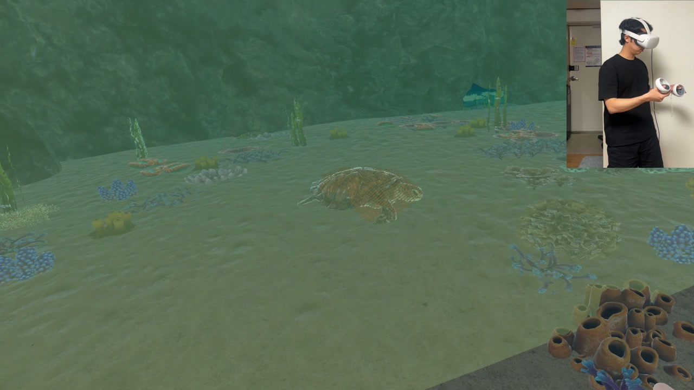
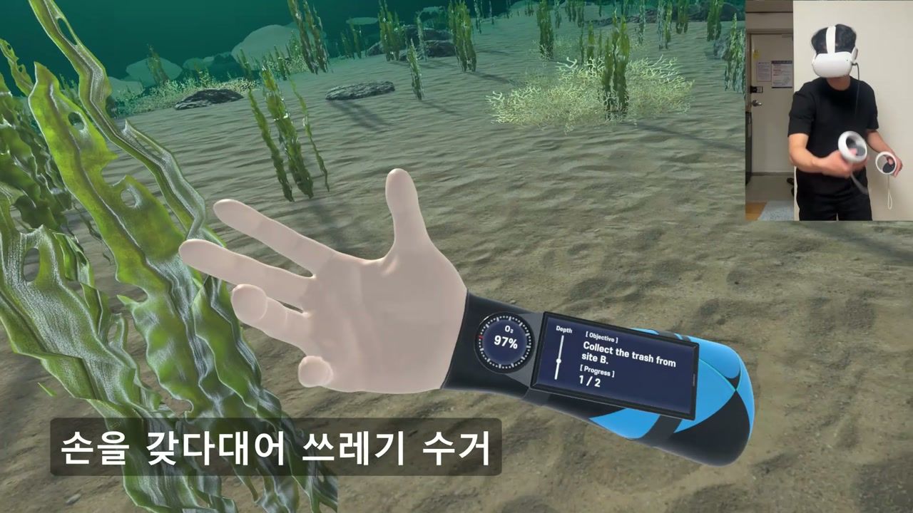
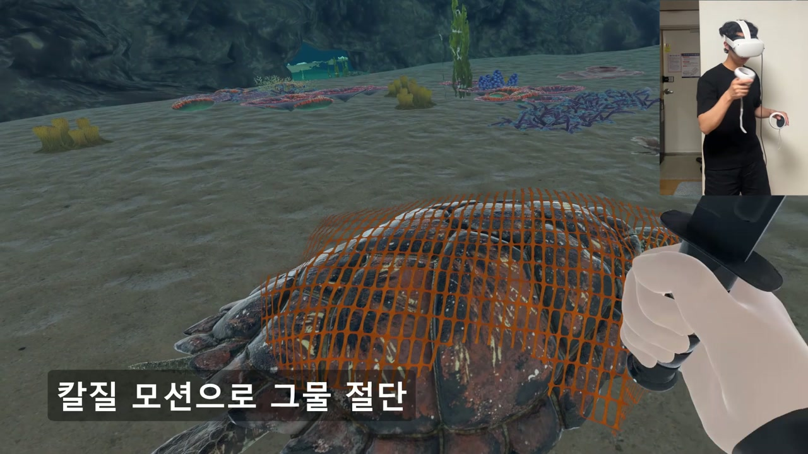
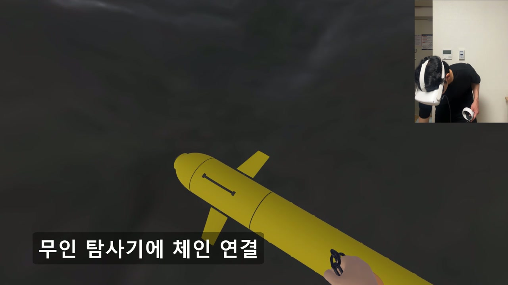

<div align="center">


# 🌊 Eco Diver

**바다를 탐험하고, 해양 환경을 지키는 VR 다이빙 게임**


[프로젝트 소개](#프로젝트-소개) · [주요 콘텐츠](#주요-콘텐츠) · [게임 화면](#게임-화면) · [기술 스택](#기술-스택)

</div>

---

## 프로젝트 소개

**Eco Diver**는 해양 환경 문제를 주제로 한 VR 게임입니다.
플레이어는 다이버가 되어 바닷속을 탐험하고, 쓰레기 수거와 해양 생물 구조, 무인 탐사기 인양 미션을 수행합니다.

VR 컨트롤러를 활용한 수중 이동과 도구 조작을 통해, 바다를 둘러보는 경험과 환경을 돌보는 활동을 연결했습니다.

## 주요 콘텐츠

| 미션 | 플레이 경험 |
| :--- | :--- |
| 🚮 **해양 쓰레기 수거** | 구역별로 흩어진 쓰레기를 찾아 수거하고 목표 수량을 달성합니다. |
| 🐢 **바다거북 구조** | 그물을 절단하는 도구를 사용해 갇힌 바다거북을 구조합니다. |
| 🤖 **무인 탐사기 인양** | 수중의 탐사기를 찾아 연결 도구를 부착하고 회수합니다. |

- **VR 수중 이동** — 양손 컨트롤러의 움직임으로 전진하고 방향을 바꿉니다.
- **도구 전환과 상호작용** — 상황에 맞는 도구를 선택해 미션을 진행합니다.
- **다이빙 정보 표시** — 산소량, 수심, 퀘스트 진행 상황과 목표 방향을 확인합니다.

> **게임 진행**
>
> 타이틀 → 프롤로그 → 쓰레기 수거 → 바다거북 구조 → 탐사기 인양

## 게임 화면

소개 영상에서 캡처한 실제 플레이 화면입니다.

<table width="100%">
  <tr>
    <td align="center" width="50%">
      
      <br><strong>수중 탐험</strong>
    </td>
    <td align="center" width="50%">
      
      <br><strong>해양 쓰레기 수거</strong>
    </td>
  </tr>
  <tr>
    <td align="center" width="50%">
      
      <br><strong>바다거북 구조</strong>
    </td>
    <td align="center" width="50%">
      
      <br><strong>무인 탐사기 인양</strong>
    </td>
  </tr>
</table>

## 기술 스택

| 구분 | 사용 기술 |
| :--- | :--- |
| 게임 엔진 | Unity **2022.3.21f1** |
| 프로그래밍 | C# · .NET Standard 2.1 |
| VR 상호작용 | XR Interaction Toolkit **2.5.3** · OpenXR **1.10.0** |
| 입력 | Unity Input System **1.7.0** |
| 해양 환경 | Crest |
| 3D 모델링 | Blender **4.1** |
| 개발 도구 | JetBrains Rider · Git · Git LFS |

## 프로젝트 구조

```text
EcoDiver/
├── Assets/
│   ├── Art/                 # 모델, 재질, 텍스처, 사운드, UI
│   ├── Crest/               # 해양 환경 패키지
│   ├── Level/
│   │   ├── Production/      # 타이틀, 프롤로그, 미션, 엔딩 씬
│   │   └── Experiment/      # 기능 및 레벨 테스트 씬
│   ├── Samples/             # XR 패키지 샘플
│   └── Script/
│       ├── Display/         # 산소량, 수심, 다이빙 정보 표시
│       ├── Environment/     # 수중 환경, 수거, 사운드, 최적화
│       ├── Equipment/       # 도구 선택 및 장비
│       ├── Interaction/     # 다이버 이동과 오브젝트 상호작용
│       ├── Quest/           # 미션 진행 및 목표 관리
│       ├── Scene/           # 씬 전환과 연출
│       └── UI/              # 메뉴, 설정, 플레이 안내
├── Packages/                # Unity 패키지 의존성
└── ProjectSettings/         # Unity 프로젝트 설정
```
